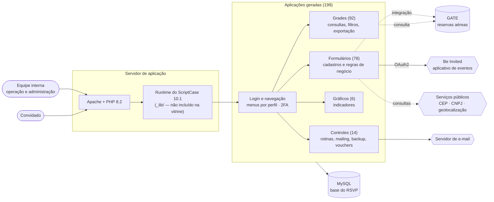
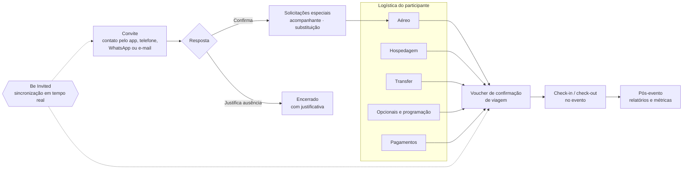
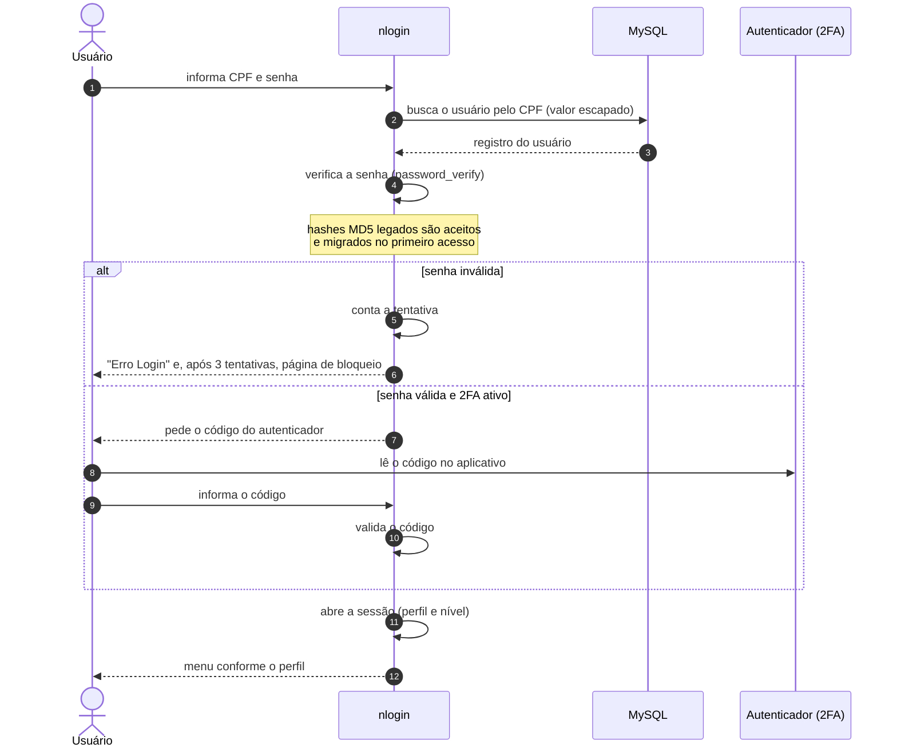
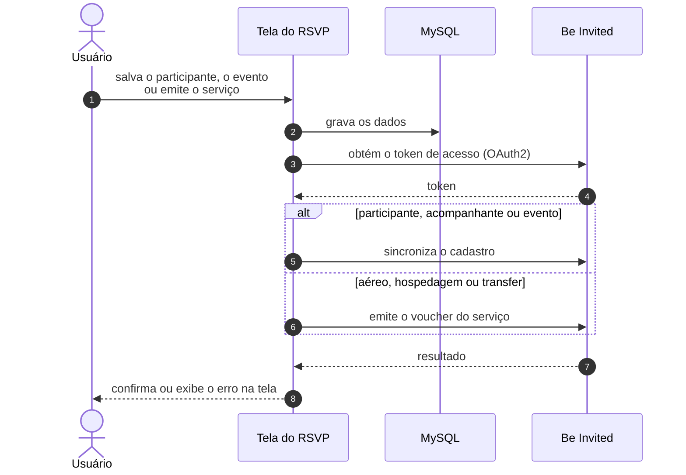
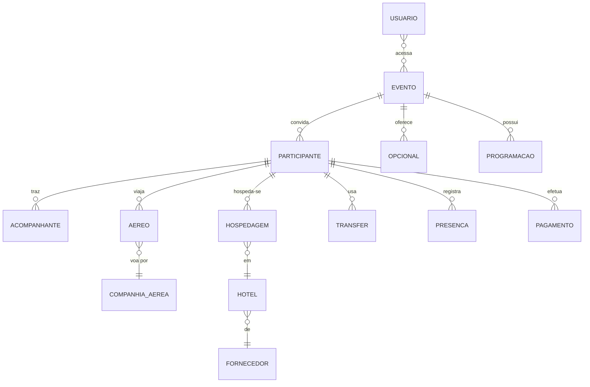

# BRSVP — Gestão de convites e participantes para eventos corporativos


-0f9d58)
-f68e30)


> **Repositório de demonstração (vitrine).** Credenciais, hosts, e-mails, dados reais e as bibliotecas de execução do ScriptCase (`_lib/`) foram removidos ou substituídos por placeholders. O código serve para **avaliação de estrutura e qualidade**; ele não é executável como está. Veja [SECURITY.md](SECURITY.md) e [LICENSE](LICENSE).

> **Preparação desta versão pública:** sanitização, revisão de segurança estática e documentação feitas com o **Claude Sonnet 5.5**, sob revisão do desenvolvedor.

---

## Sumário

1. [Visão geral](#1-visão-geral)
2. [Problema e solução](#2-problema-e-solução)
3. [Arquitetura](#3-arquitetura)
4. [Ciclo de vida do convidado](#4-ciclo-de-vida-do-convidado)
5. [Login e autenticação em dois fatores](#5-login-e-autenticação-em-dois-fatores)
6. [Integração com o Be Invited](#6-integração-com-o-be-invited)
7. [Módulos funcionais](#7-módulos-funcionais)
8. [Modelo conceitual de dados](#8-modelo-conceitual-de-dados)
9. [Números do projeto](#9-números-do-projeto)
10. [Segurança](#10-segurança)
11. [Tecnologias e ambiente](#11-tecnologias-e-ambiente)
12. [Como avaliar o código](#12-como-avaliar-o-código)
13. [Estrutura do projeto](#13-estrutura-do-projeto)
14. [Limitações conhecidas e próximos passos](#14-limitações-conhecidas-e-próximos-passos)
15. [Contato](#15-contato)

---

## 1. Visão geral

O **BRSVP** é um sistema de gestão de convidados para **eventos corporativos**, desenvolvido pela **UN Belvitur (BeFly)**. Diferentemente de sistemas de RSVP passivos, que apenas registram a confirmação, o BRSVP **gerencia o ciclo de vida completo do participante**: do convite ao pós-evento, passando por **aéreo, hospedagem, transfer, opcionais, programação e pagamentos**, com **integração em tempo real** com o aplicativo **Be Invited**.

Versão da documentação: **1.20.10x**.

## 2. Problema e solução

| Desafio | Como o BRSVP resolve |
|---|---|
| Confirmação de presença dispersa (telefone, WhatsApp, e-mail) | Registro único do convite, da resposta e das justificativas de ausência |
| Solicitações especiais (acompanhante extra, substituição) | Telas dedicadas, com trilha de quem solicitou e do que mudou |
| Logística espalhada entre planilhas | Módulos de **aéreo, hospedagem, transfer e opcionais** ligados ao mesmo participante |
| Documento de viagem manual | **Voucher de confirmação de viagem** gerado e enviado a partir dos dados do sistema |
| Controle de entrada e saída no evento | **Check-in/check-out digital** |
| Equipe e convidado precisam da mesma informação | Integração com o **Be Invited**, que sincroniza convidados, eventos e vouchers |
| Acesso a dados sensíveis | Menus por perfil, **login com 2FA**, bloqueio de acessos e logs de uso |
| Prestação de contas ao cliente | Grades com filtros e exportação, gráficos e relatórios gerenciais |

## 3. Arquitetura

Aplicação **web em PHP** gerada pelo **ScriptCase 10.1**: um conjunto de aplicações (formulários, grades, gráficos, controles e menus) que compartilham a mesma base e o mesmo *runtime*. Cada aplicação tem versão **desktop e mobile**.



| Camada | Aplicações | Responsabilidade |
|---|---|---|
| Acesso | `nlogin`, `nlogin_csp`, `form_usuarios_rsvp_2fa` | Autenticação, 2FA e sessão |
| Navegação | `acesso_menus`, `administrativo_menu`, `convidado_menu` | Menus conforme o perfil |
| Cadastros | `form_*` | Entrada de dados e regras de negócio |
| Consultas | `grid_*` | Listagens, filtros, totais e exportação |
| Indicadores | `chart_*` | Gráficos de aéreo, hospedagem, participantes e presenças |
| Rotinas | `control_*`, `blank_*`, `envia_email`, `cv_chkinout` | Mailing, backup, vouchers, check-in, utilitários |

## 4. Ciclo de vida do convidado



## 5. Login e autenticação em dois fatores

O acesso exige **CPF e senha** e, para os usuários que habilitaram o recurso, um **código de dois fatores** (Google Authenticator).



## 6. Integração com o Be Invited

Telas que alteram dados de convidados, acompanhantes, eventos e serviços de viagem sincronizam com o **Be Invited**, autenticando-se por **OAuth2** (credenciais de aplicação, obtidas a cada uso).



| Dado sincronizado | Telas que originam |
|---|---|
| Convidados e acompanhantes | `form_participantes_rsvp`, `form_acompanhantes_rsvp` (e suas variantes) |
| Eventos | `form_eventos_rsvp`, `grid_eventos_rsvp` |
| Vouchers de viagem | `form_aereos_rsvp_1`, `form_hospedagem_rsvp`, `form_transfer_rsvp` |

> Os endereços e as credenciais da integração **não** fazem parte da vitrine.

## 7. Módulos funcionais

| Área | Aplicações principais |
|---|---|
| **Acesso e segurança** | `nlogin`, `nlogin_csp`, `form_usuarios_rsvp`, `form_usuarios_rsvp_2fa`, `grid_usuarios_*`, `control_bloq_ac` |
| **Convidados e participantes** | `form_participantes_rsvp`, `form_acompanhantes_rsvp`, `form_pessoas_rsvp`, `grid_participantes_rsvp_*`, `grid_acompanhantes_rsvp_*` |
| **Presença e voucher** | `form_presencas_rsvp`, `form_confirmacao_viagem_rsvp`, `control_voucher_ac`, `chart_presencas_rsvp` |
| **Aéreo** | `form_aereos_rsvp_1`, `form_aereos_rsvp_2`, `form_aereos_rsvp_ctrecho`, `form_aereos_rsvp_gate`, `form_bloqueio_aereo_*`, `chart_aereos_rsvp` |
| **Hospedagem** | `form_hospedagem_rsvp`, `form_bloqueio_hoteis_rsvp_1`, `grid_roomlist_rsvp_*`, `chart_hospedagem_rsvp` |
| **Transfer** | `form_transfer_rsvp`, `grid_transfer_rsvp`, `grid_trinaer_*`, `grid_trlocal_*`, `grid_trouaer_*`, `grid_trprop_*` |
| **Eventos, programação e opcionais** | `form_eventos_*`, `form_programac_rsvp`, `form_eventos_opcionais_*`, `form_eventos_tours_*`, `form_eventos_publicos_*`, `form_eventos_regionais_*` |
| **Financeiro** | `form_pagamentos_rsvp`, `grid_pagamentos_rsvp` |
| **Solicitações e substituições** | `form_solicitacoes_rsvp`, `grid_solicitacoes_rsvp_r`, `grid_substituicoes_rsvp_r`, `blank_desfaz_subst` |
| **Comunicação** | `envia_email`, `control_mailling`, `control_mail_ac`, `grid_mailling_rsvp`, `grid_modelo_mailling_rsvp`, `form_contatos_*` |
| **Check-in e check-out** | `cv_chkinout`, `control_cv`, `control_cv_new` |
| **Relatórios** | `control_rel_01`, `control_rel_02`, `grid_geral_rsvp_r`, `grid_rsvp_part_r`, `grid_status_rsvp` |
| **Logs e backup** | `form_rsvp_log`, `form_rsvpses_log`, `grid_rsvp_log_*`, `control_bkp`, `control_log_bkp` |
| **Tabelas auxiliares** | `form_tbl_*` e `grid_tbl_*` (hotéis, redes, cidades, UFs, países, aeroportos, companhias aéreas, fornecedores, tours, opcionais, regionais...) |
| **Navegação** | `acesso_menus`, `administrativo_menu`, `convidado_menu` |

As grades permitem **exportar** em PDF, Excel, CSV, XML, JSON e RTF, ou imprimir.

## 8. Modelo conceitual de dados

Visão **conceitual**, derivada dos módulos acima, para facilitar a leitura. O esquema físico do banco **não** faz parte da vitrine.



## 9. Números do projeto

| Tipo | Quantidade |
|---|---:|
| Formulários (`form_*`) — dos quais 18 são tabelas auxiliares | 78 |
| Grades (`grid_*`) | 92 |
| Controles (`control_*`) | 14 |
| Gráficos (`chart_*`) | 6 |
| Menus | 3 |
| Login | 2 |
| Utilitários (`blank_*`, `envia_email`, `cv_chkinout`) | 4 |
| **Total de aplicações** | **199** |

São cerca de **5.900 arquivos PHP**, pois cada aplicação tem versão **desktop e mobile** e arquivos gerados para cada formato de exportação.

## 10. Segurança

| Tema | Controle |
|---|---|
| Autenticação | Login por CPF e senha, com **2FA** (Google Authenticator) para os usuários habilitados |
| Força bruta | Contador de tentativas inválidas e **página de bloqueio** após 3 tentativas |
| Senhas | `password_hash` / `password_verify`; hashes MD5 legados são aceitos e **migrados** no primeiro acesso |
| Consultas ao banco | Valores **escapados** no login; camada de dados do ScriptCase nas demais telas |
| Transporte | Verificação de certificado **SSL** habilitada nos clientes `curl` |
| Perfis | Menus e opções conforme o perfil do usuário; **bloqueio de acessos** (`control_bloq_ac`) |
| Auditoria | Registros de acesso, de sessão e de ações (`form_rsvp_log`, `form_rsvpses_log`, `grid_rsvp_log_*`) |
| Segredos | Nenhum segredo no repositório: credenciais, hosts e e-mails são **placeholders** |
| Dados pessoais | Nenhum dado real; o sistema trata dados de participantes (**LGPD**) |

> **Transparência:** a revisão de segurança desta vitrine foi **estática** (leitura de código e busca de segredos). Não substitui um teste de invasão nem uma auditoria de dependências. Detalhes em [SECURITY.md](SECURITY.md).

## 11. Tecnologias e ambiente

| Componente | Detalhe |
|---|---|
| Plataforma de desenvolvimento | **ScriptCase 10.1** (build 1) |
| Linguagem | **PHP 8.2** |
| Servidor web | Apache 2.4 |
| Banco principal | **MySQL** (conexão da aplicação) |
| Sistema de reservas aéreas | Conexão dedicada ao **GATE** |
| Front-end | HTML5, CSS3, JavaScript e jQuery |
| 2FA | Google Authenticator |
| Integração | API do **Be Invited** (OAuth2) |
| Proteção de código | Source Guardian (em produção) |

**Hospedagem:** VPS recomendada. Em hospedagem compartilhada, o diretório do `wkhtmltopdf` exige permissão de escrita e execução.

## 12. Como avaliar o código

O código das aplicações é **gerado** pelo ScriptCase; o que há de mais autoral está nos **eventos e regras** dentro de cada aplicação. Sugestão de leitura:

| Para avaliar | Onde olhar |
|---|---|
| Login, 2FA e tentativas | `nlogin/nlogin_apl.php` |
| Regras do convidado e integração com o Be Invited | `form_participantes_rsvp/`, `form_acompanhantes_rsvp/` |
| Logística de viagem e vouchers | `form_aereos_rsvp_1/`, `form_hospedagem_rsvp/`, `form_transfer_rsvp/` |
| Rotinas, mailing e backup | `control_mailling/`, `control_bkp/`, `envia_email/` |
| Consultas e exportações | `grid_participantes_rsvp_1/`, `grid_geral_rsvp_r/` |
| Indicadores | `chart_participantes_rsvp/`, `chart_presencas_rsvp/` |

## 13. Estrutura do projeto

```text
brsvp/
├── Acesso e navegação
│   ├── nlogin/ · nlogin_csp/            # login (com 2FA)
│   ├── acesso_menus/                    # menus por perfil
│   ├── administrativo_menu/             # menu administrativo
│   └── convidado_menu/                  # menu do convidado
├── Cadastros
│   └── form_*/                          # 78 formulários (eventos, participantes, aéreo, hotel, transfer...)
├── Consultas e relatórios
│   └── grid_*/                          # 92 grades com filtros e exportação
├── Indicadores
│   └── chart_*/                         # 6 gráficos
├── Rotinas e operação
│   ├── control_*/                       # mailing, backup, vouchers, relatórios
│   ├── cv_chkinout/                     # check-in / check-out
│   ├── envia_email/                     # envio de e-mail
│   └── blank_*/                         # utilitários
├── index.php
├── LICENSE · SECURITY.md · README.md
└── (_lib/ — runtime do ScriptCase, não incluído)
```

## 14. Limitações conhecidas e próximos passos

- O repositório **não é executável** sozinho: falta o *runtime* do ScriptCase (`_lib/`) e a configuração das conexões.
- Não há suíte de testes automatizados neste repositório.
- Adicionar `Content-Security-Policy` e HSTS no servidor web, e manter os segredos das integrações em configuração externa ao código.
- Migrar por completo as senhas legadas para o novo formato (a migração acontece no primeiro acesso de cada usuário).
- Revisar periodicamente as integrações externas e rotacionar credenciais.

## 15. Contato

- E-mail: daniel@belvitur.com.br
- E-mail alternativo: daso.tecnologia@gmail.com

---

© UN Belvitur / BeFly - Todos os direitos reservados — código disponibilizado exclusivamente para avaliação. Veja [LICENSE](LICENSE).
